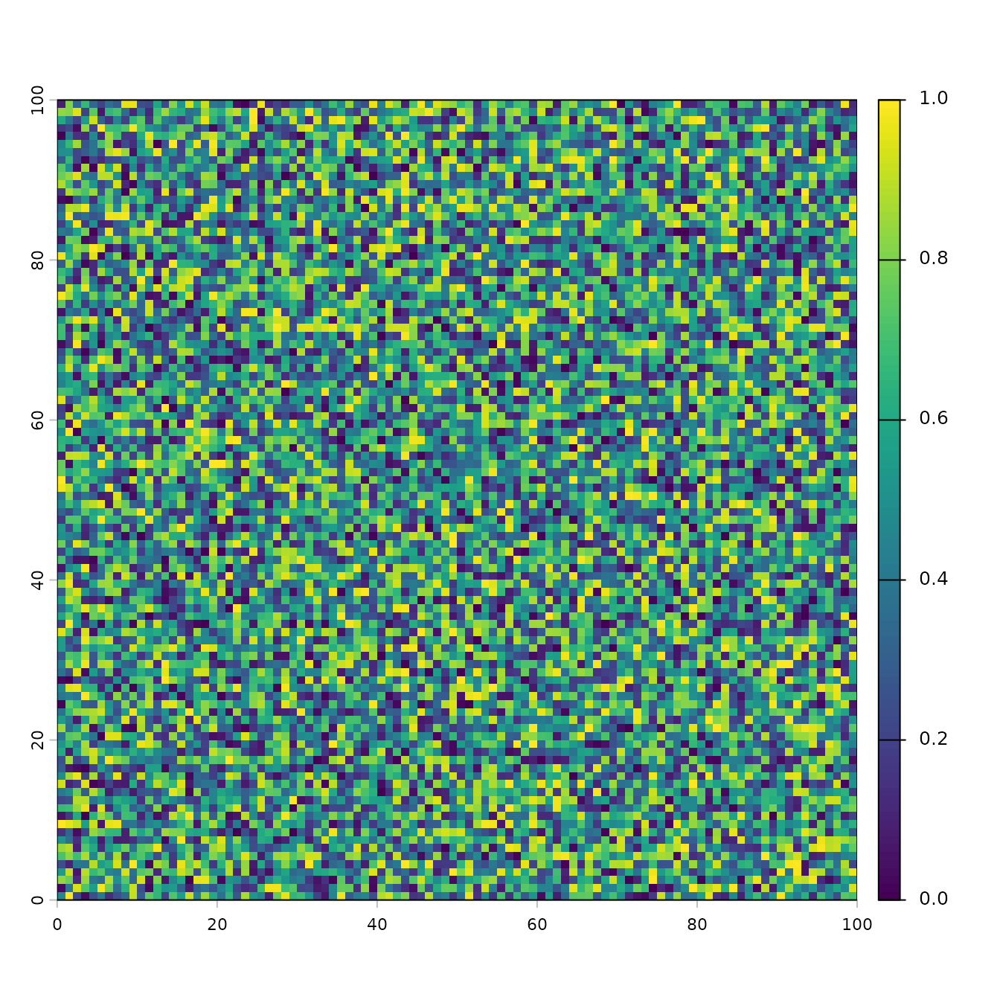
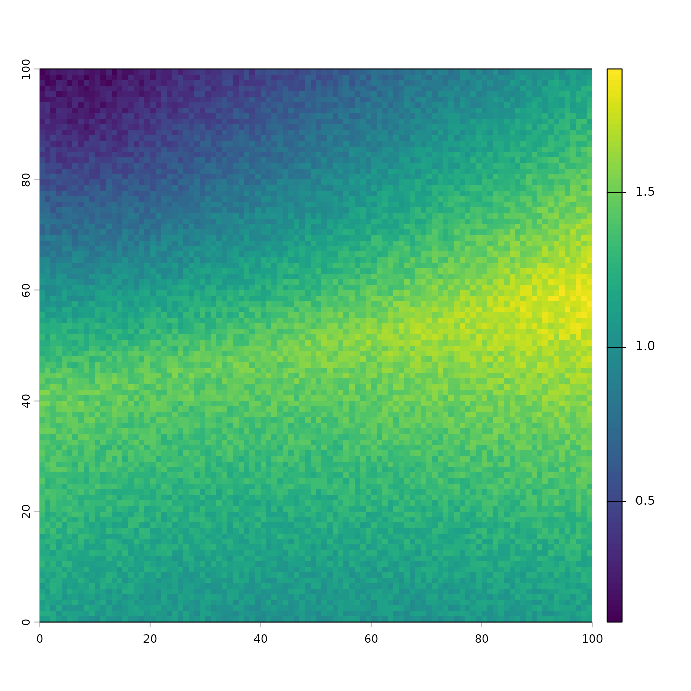
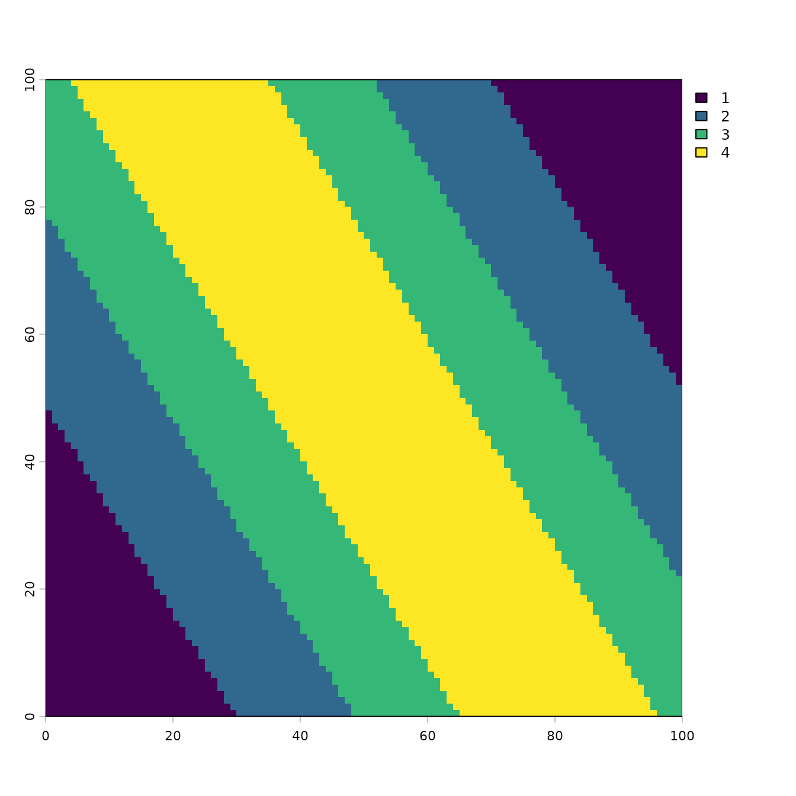

# Basic Usage of NLMR

`NLMR` is an R package for simulating neutral landscape models (NLMs):
synthetic landscapes used to explore landscape-scale ecological patterns
and processes. The package follows the same general idea as the Python
package `NLMpy` (see Etherington et al. 2014), but returns results as
`SpatRaster` objects so they can be used directly with `terra` and other
raster workflows. Most of the common NLMs described in the literature
are available. The package also includes tools for classifying
continuous outputs into categories.

For more background on neutral landscape models and the package design,
see the accompanying publication Sciani, Fritsch, Scherer and Simpkins
(2018).

## Quickstart

`NLMR` exposes 15 exported landscape-generation functions covering 16
algorithm variants. The variants span a spectrum of spatial structure,
from spatially random landscapes (`nlm_random`) through intermediate
patterned forms to deterministic planar gradients (`nlm_planargradient`)
(see Palmer 1992). The curdling generator,
[`nlm_curds()`](https://docs.ropensci.org/NLMR/reference/nlm_curds.md),
can produce either random curdling or wheyed curdling, which is why the
package has one more algorithm variant than exported function. For a
full browseable catalog of generators, use
[`catalog_nlm()`](https://docs.ropensci.org/NLMR/reference/catalog_nlm.md).

The plot below shows a basic random landscape with no intentional
spatial structure.

A simple random landscape can be generated like this:

``` r

x <- NLMR::nlm_random(ncol = 100, nrow = 100)
terra::plot(x)
```



## Combining landscapes

NLM rasters can be combined to create new landscape patterns. A base
raster can be added to one or more secondary rasters, with optional
scaling factors controlling how strongly each secondary raster
contributes. This example combines a gradient with random variation to
create a more complex surface.

``` r

base <- NLMR::nlm_edgegradient(ncol = 100, nrow = 100)
secondary_1 <- NLMR::nlm_distancegradient(
  ncol = 100,
  nrow = 100,
  origin = c(10, 10, 10, 10)
)
secondary_2 <- NLMR::nlm_random(ncol = 100, nrow = 100)

combined <- base + (secondary_1 + secondary_2 * 0.2)
terra::plot(combined)
```



## Classifying categories

Landscape rasters generated by `NLMR` are continuous by default and
often fall between 0 and 1. Use
[`landscape_classify()`](https://docs.ropensci.org/NLMR/reference/landscape_classify.md)
to convert a continuous raster into categorical classes when you want a
discrete landscape representation. This example turns a continuous
gradient into four discrete classes.

``` r

continuous <- NLMR::nlm_edgegradient(ncol = 100, nrow = 100)
classified <- landscape_classify(continuous, n = 4)
terra::plot(classified)
```



## References

Etherington, Thomas R., E. Penelope Holland, and David O’Sullivan. 2014.
“NLMpy: A Python Software Package for the Creation of Neutral Landscape
Models Within a General Numerical Framework.” *Methods in Ecology and
Evolution* 6 (2): 164–68. <https://doi.org/10.1111/2041-210X.12308>.

Palmer, Michael W. 1992. “The Coexistence of Species in Fractal
Landscapes.” *The American Naturalist* 139 (2): 375–97.
<https://doi.org/10.1086/285332>.

Sciaini, Marco, Matthias Fritsch, Cédric Scherer, and Craig Eric
Simpkins. 2018. “NLMR and Landscapetools: An Integrated Environment for
Simulating and Modifying Neutral Landscape Models in r.” *Methods in
Ecology and Evolution* 0 (0). <https://doi.org/10.1111/2041-210X.13076>.
